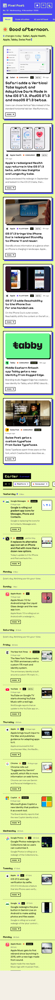
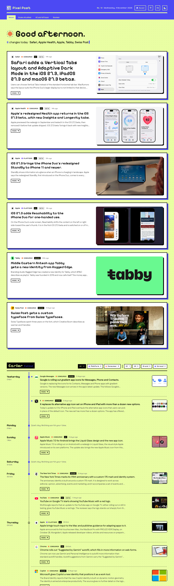

# Pixel Post

A morning paper for one: what apps, sites and brands changed in **UI design, UX and brand identity**, filtered so only real design changes get through. In English or Chinese.

Every morning from 07:00 (or as soon as the laptop is on and online after that) a job on the laptop reads news feeds, applies strict rules, asks the company plan model to pick what is worth your time and write it up, and uploads the result. GitHub then publishes it as a static page at https://design-updates.github.io/. Today's changes are on top; older days are listed below with a date rail, category filters and unread dots.

| Phone (375px) | Desktop (1280px) |
| --- | --- |
|  |  |

## How a run works

1. **Feeds.** Every RSS/Atom feed in `watchlist.yaml` is read: company newsrooms, tech news sites, and design and branding publications (It's Nice That, Dezeen, BP&O, PRINT and others).
1. **Store version notes (changes nobody announces).** The latest App Store and Google Play version of every watchlist app is read. A version not seen before, released inside the window, whose notes mention a design change (redesign, new look, layout, home, tab, navigation...) becomes a candidate like a news story. Boilerplate ("bug fixes and performance improvements") is ignored, so this fires rarely. What was seen is kept in `data/stores.json`, with every App Store screenshot rewritten to its largest available rendition for visual checking.
2. **Search (Anthropic API only).** One call per app group (OTAs, rail, delivery and rides, platforms, consumer) with the web search tool, limited to the apps' own sites and the trusted outlets list. This catches newsrooms that have no feed. The company plan and Gemini have no working web search, so with those the run uses feeds only.
3. **Rules (no model).** Each item is dropped, with a reason, if it comes from a blocked or unknown site, has no real publish date or is older than 48 hours, has a drop word in the headline ("funding", "deals", "rumor"...), or was already reported. From news sites, an item must be about a watchlist app or have a design word in its headline (redesign, rebrand, new logo, interface, onboarding...). Everything from a design publication goes through. Search results are dated by the article page itself, not by the search engine.
4. **One curate call.** The model gets everything that passed, plus what was reported in the last two weeks. It keeps only design changes of three kinds: **UI** (the interface: redesigns, layout, visual style, icons, platform design rules), **UX** (how a flow works: navigation, onboarding, search, checkout, sign-in) and **Brand** (logos, identity, type, colour, app icons). Feature news with no visible design angle is dropped. Watchlist apps come first, but any well-known app, site or brand counts. It merges syndicated copies of one launch into one item (keeping the two best sources), drops the rest with a reason, and writes `headline`, `what` and `why` for each item in English and in Simplified Chinese (`zh`). It adds a `pattern` note (and `pattern_zh`) only when three or more apps moved the same way.
5. **The picture.** For each kept item, `company.compare` (currently the same GPT-6.1 Sol model as curation) looks at the pictures in its source articles, downloaded and sent with the headline and intrinsic dimensions. It prefers a verified before/after over a new-only image, then the clearest high-resolution image that shows the change itself: the grid of new icons rather than the bare logo, the new screen rather than a photo of the company. Undersized source thumbnails are rejected before selection. If the pictures show the old design and the new, the page shows them side by side. Captions that name the old and new picture ("the previous logo", "Apple-Music-icon-old.jpg") are used as they are, without asking. Pictures uploaded more than two months before the story are left out, since they belong to older articles linked on the page. A pair chosen earlier is never replaced. App Store notes contribute every available screenshot at its largest rendition, but the model must still verify that it shows this specific change. Hand-reviewed local assets are registered in `data/verified-assets.json`; the build refuses them if their story, role, credited source, dimensions, exact bytes, or file inventory changes.
6. **Checks.** The answer is validated in code: unknown apps, missing sources and incomplete write-ups are dropped; emojis and exclamation marks are removed; hype words are flagged in the log. Each kept page is re-read for its `og:image` and to make sure it is not an old story with a new date.
7. **Write.** `data/radar.json` gets a new day at the top. A quiet day is recorded as `"quiet": true` with no items. `data/seen.json` remembers every reported event, so a launch never shows up again on a later day. `data/runs.json` logs token use and estimated cost per run.

Running twice on the same day only adds genuinely new items to today. Past days are never rewritten. If no source could be read at all, the run fails and writes nothing, rather than claiming a quiet day.

## Commands

Needs Node 24 or newer. There are no npm packages to install.

```bash
npm run collect
```

Runs the job and prints what it kept and what it dropped, with the reason for each. Options (after `--`):

| Option | What it does |
| --- | --- |
| `--dry-run` | Read feeds and apply the rules, call no model, write nothing. |
| `--no-search` | Feeds only. |
| `--manual` | Do the model step by hand instead of using the API (see below). |
| `--gather-only` | Read sources and pages, save them to `.cache/`, stop. |
| `--from-cache` | Use the sources saved by `--gather-only` instead of reading the network. Good for trying another model on the same news. |
| `--backfill N` | Also fill the N−1 days before today, oldest first. Past days use feeds only. |
| `--data DIR` | Write `radar.json` and the rest to DIR instead of `data/`, for trial runs. |
| `--verbose` | List every dropped item, including the hundreds of old and off-topic ones. |

Other commands:

- `npm run check-feeds`: tests every feed URL and says how fresh each one is. Run it after adding a source.
- `npm run backfill-compare`: picks the picture again for items already in `radar.json`, by re-reading their pages: items with no before/after, or with `-- --days N` every item from the last N days (`-- --dry-run` to only show what it would do). `-- --missing` keeps only cards with no picture or a site's stock share card. Only `compare` and `image` change.
- `npm run icons`: looks up app icons again (App Store artwork, or a favicon) and saves them to `data/icons.json`.
- `npm run build`: builds the site into `dist/`.
- `npm run dev`: builds and serves the site at http://localhost:5180.
- `npm run workflows`: adds today's posts to the AI workflows pool and, on the first run of a week, picks that week's posts (see below). `-- --dry-run` reads and filters without calling the model; `-- --force` picks the current week again.
- `npm run cases`: the same for the Case studies page (see below), with the same options.
- `npm test`: runs the tests.

### Which AI it uses

Set `provider:` in `watchlist.yaml`, or `RADAR_PROVIDER` in the environment, to one of:

| Provider | Where it works | Login | Web search |
| --- | --- | --- | --- |
| `company` | Your laptop only (Trip.com network) | Run `ada cc` once in Terminal, log in, type `/exit`. Model: `company.curate` (currently `claude-gpt-6.1-sol[1M]`) | No |
| `gemini` | GitHub only (Google blocks the API from mainland China) | `GEMINI_API_KEY`. Model: `gemini.curate` (default `gemini-3.8-flash`, free tier) | No |
| `anthropic` | Anywhere Anthropic serves | `ANTHROPIC_API_KEY` | Yes |

The morning job uses `company`. Keys for the other two go in `.env` (copy `.env.example`); it is git-ignored. If the company login expires, run `ada refresh` in Terminal and log in again.

Gemini was tried on GitHub in October 2026 and not used: it timed out on several calls, invented a detail, and dropped good stories.

### Running without a key

`npm run collect -- --manual` saves the model's question to `.cache/llm/requests/<id>.json` and stops. Write the JSON answer to the `answer_to` path in that file (for example by pasting the question into a Claude chat), then run the same command again. The second run reuses the sources saved the first time, so it works offline. Web search is skipped in this mode. The seed data in this repo (23 to 29 October 2026) was made this way from real feeds.

## Editing the watchlist

Everything is in `watchlist.yaml`; no code changes needed.

**Add an app.** Add an entry under one of the five groups (`ota`, `rail`, `delivery`, `platform`, `consumer`):

```yaml
      - name: Kayak
        aliases: [Kayak]             # words that mark a headline as about this app (exact capitals)
        domains: [kayak.com]         # its own sites; count as first-party sources
        appstore_id: 305204535       # optional, for the icon and App Store notes
        play_id: com.kayak.android   # optional, for Google Play notes
        store_country: in            # only for apps not in the US App Store (Zomato: in, Careem: ae, Meituan: cn)
```

Then run `npm run icons` to fetch its icon. An app can only be in one group. The group decides its category dot on the page.

**Remove an app.** Delete its entry. Items already published stay in `radar.json`.

**Change what gets searched.** Each group has a `search:` list of starting queries. `models.searches_per_group` caps how many searches the model may run per group; set it to `0` to turn search off and cut cost.

**Change the rules.** `window_hours` (default 48), `trust.outlets` (sites trusted for search results), `trust.blocked_domains` (never kept) and `trust.drop_words` (headline words that drop an item before the model sees it). Keep drop words specific: `shares` alone would also drop "Apple shares new design guidance".

**Your name in the greeting.** Set `reader:`.

**Add a design source.** Add a feed with `kind: design`. Every item from it goes to the model, which names the brand, so use it only for publications that are mostly about design. Also add its domain to `trust.outlets`.

## Adding a source

Add a feed under `feeds:`:

```yaml
  - name: Kayak Newsroom
    url: https://www.kayak.com/news/feed/
    kind: company      # company: every item is about `app`
    app: Kayak         # outlet: items are matched to apps by alias instead
```

**A newsroom with no feed** can be read as a web page: give its address and a `page` pattern (a regular expression on the path) that matches its article links. Each matching link is read for its title, date, summary and picture, then treated like a feed item:

```yaml
  - name: Airbnb Newsroom
    url: https://news.airbnb.com/
    kind: company
    app: Airbnb
    page: '^/[a-z0-9]+(-[a-z0-9]+){2,}/?$'   # one-segment slugs with at least three words
```

This only works when the articles carry a readable date (a publish-date meta tag, structured data, or a `<time>` element); without one the 48-hour rule drops them all.

Run `npm run check-feeds` to confirm it works. If a site has no feed, add its domain to the app's `domains` (for a company) or to `trust.outlets` (for a news site) so the search step covers it instead.

The watchlist covers 58 apps: OTAs and metasearch (Expedia, Booking.com, Airbnb, Agoda, Trip.com, Skyscanner, MakeMyTrip, Traveloka, Priceline, trivago, Fliggy and others), rail and buses (Trainline, Omio, Amtrak, SNCF Connect, DB Navigator, Eurostar, Trenitalia, Renfe, 12306, IRCTC, ixigo, Korail, FlixBus), food delivery and rides (Uber, Uber Eats, Lyft, Grab, Careem, Bolt, Gojek, DiDi, DoorDash, Grubhub, Zomato, Swiggy, Noon, foodpanda, Delivery Hero, Deliveroo, Meituan), platforms and consumer apps. Delivery Hero has no app of its own; its entry follows talabat and also matches news about Glovo, Baemin and PedidosYa. Short everyday names are matched only in their app forms ("GrabFood", "Bolt Food", "noon app"), so "grab a coffee" or "Usain Bolt" is not news about them. There is one App Store lookup per country. Some Google Play pages carry no "What's new" notes (Airbnb, Instagram, Zomato, Careem in November 2026); for those only the App Store notes are read.

**Major tech sites** (November 2026): Android Police, XDA, Android Central, SamMobile, Droid Life, GSMArena, AppleInsider, MacStories, TechCrunch, Engadget, Ars Technica, Wired, CNET, Digital Trends, TechRadar, Tom's Guide, Mashable and Social Media Today, next to 9to5Mac, 9to5Google, MacRumors, The Verge and Android Authority. Not reachable: PhoneArena, Gizmodo, The Next Web, Cult of Mac, Neowin, Windows Central. With more sites, more headlines pass the rules, so `max_candidates` is 200 and headlines with design words are kept before plain app news.

**Pictures from other coverage.** A change usually reaches several sites. When the site behind a story blocks readers or has no usable picture, the picture step also looks at other articles about the same story read that run (same app, headlines sharing the words that name the story, within three days), and as a last resort searches 9to5Google, 9to5Mac, TechCrunch and Droid Life for earlier reports (up to three weeks back; YouTube's tab bar was first reported on 22 Oct, the backlash on 4 Nov). The site whose picture is used is added to the story's sources. A before/after pair named only by file names must be of the same thing, and comes from one article. A card still without a picture of the change then gets a second, wider search: Google News lists who else covered the story (its links are redirects that can't be followed, but it gives each result's site and headline), and the real article is found in that site's news sitemap. Store screenshots and app logos are never substituted for the reported change. If no source or exact alternate coverage provides a verifiable image of that change, the story is not published.

**Duplicates.** The model sees the last 14 days, and code checks stable event ids, matching source URLs, same-app headline similarity, and meaningful event-word containment across product-family names. A focused follow-up such as Phone by Google's gradient icon is treated as a duplicate if a broader Messages, Phone and Contacts gradient-icon rollout was already reported. Genuinely different changes to the same app remain separate.

YouTube (November 2026): its official blog (blog.youtube) is read as a company feed; `youtube.com` itself stays in `blocked_domains`, since video links are not news. Android Authority's feed is read, but its rendered article pages refuse this reader; exact images can still come from alternate reporting or a public source post linked by the article. A reused stock header is never accepted as the change image.

Delivery and rides (November 2026): Grab, Amtrak, Priceline and trivago have feeds; Lyft, Bolt and Traveloka are read as newsroom pages. DoorDash, Grubhub, Delivery Hero, foodpanda, Noon, Careem, Deliveroo and Eurostar block readers; Uber's newsroom has no article dates and Zomato's blog no article titles. TechCrunch Transportation, Restaurant Dive and Inc42 cover those companies instead, with the store notes.

Travel companies (November 2026): Booking.com, KAYAK and Tripadvisor have newsroom feeds; Airbnb, Agoda and Trip.com are read as newsroom pages. **Expedia cannot be read**: expedia.com (including its product release pages such as expedia.com/product/release/fall2026/) and Expedia Group's newsroom block automated readers, even a real Chrome, and so do Skyscanner, Omio, Trainline and PhocusWire. Their bigger releases still arrive through Skift, The Verge, 9to5Mac and TechCrunch, and Expedia's app updates through the App Store and Google Play notes. Hopper's media center reads fine but its articles carry no machine-readable date, so it is left out.

When this was first set up (October 2026) there was no working public feed for Google Design / Material Design. From the laptop's network, Brand New, Design Week, Creative Review and Fast Company Co.Design could not be reached either. (Creative Bloq worked when checked again in November 2026 and was added.)

**X and LinkedIn are not read directly.** X's API is paid only (from $0.005 per post read). LinkedIn only lets you read pages you administer, and scraping it breaks its terms. Big design news posted there usually reaches the outlets and design publications in the list, so it still gets picked up. The Airbnb, Uber, Spotify and Google Design blogs on Medium were also tried; their newest posts are 1 to 8 years old.

`medium.com` is in `blocked_domains` because anyone can publish there. A feed you add yourself is exempt for its own posts (the Netflix Tech Blog lives on Medium), but a Medium link reached through another feed is still blocked.

## AI workflows (trial)

A second page, **AI workflows**, collects posts in which designers show how they actually use AI in their work: the steps, prompts and tools, what came out, and where the AI fell short. It is a weekly list, not a daily one.

- **Sources** are in `workflows.yaml`: UX Collective, UX Planet, Smashing Magazine, Nielsen Norman Group, UX Tigers, Luke Wroblewski, the Figma Blog, Lenny's Newsletter, One Useful Thing and Sidebar. X and LinkedIn are not readable for free.
- **Every morning** the job reads those feeds and adds new posts to a pool (`.cache/workflows-pool.json`), because some feeds only hold a day or two of posts.
- **On the first run of each week** it takes the last 7 days of posts, drops the obvious misses with rules (not about AI, listicles such as "10 AI tools…", courses, job posts), reads each remaining post in full, and asks the company Claude which ones show a real process someone could copy. Each post gets a score out of 10; at most `max_picks` (5) with at least `min_score` (7) are kept. A week where nothing is good enough is shown as quiet.
- **Each pick** has a plain title, the author and their role when the post says, the tools, the stage of design work, the process, the result, the catch (only if the post names one) and who should try it, in English and Chinese.
- **Output:** `data/workflows.json`. `npm run workflows` prints what was kept and dropped with the reason for each; the last report is in `.cache/workflows-last.txt`.
- **To turn it off:** set `enabled: false` in `workflows.yaml`. The tab disappears from the page and the morning job skips it.

## Case studies

A third page, **Case studies**, collects the most inspiring design case studies of shipped work from well-known companies: what the problem was, what the team did and why, what happened, and one thing to take away. It is a weekly list.

- **Sources** are in `casestudies.yaml`: company design and product blogs (Microsoft Design, Slack Design, Discord, Duolingo, IBM Design, Lyft Design, Thumbtack, Linear, Stripe, GitHub), company engineering blogs that sometimes cover product and design work (Airbnb, Netflix, Pinterest, Spotify, Shopify, Meta, Dropbox, Grab, Nubank, Expedia Group, Booking.com), and the design press (Fast Company Design, Design Week, Awwwards, UX Collective, Smashing Magazine). The file also lists the sources tried and left out, and why.
- **On the first run of each week** it takes the posts from the last `window_days` (14), because company blogs post a case every few weeks, not every day. Rules drop posts with no design words (most engineering posts), patch notes, interviews, newsletters and posts in other languages. The company Claude then keeps only work for a well-known company that shipped and explains the case. Concepts, course projects, small local businesses, ad campaigns, architecture and engineering-only posts are dropped. Each case gets a score out of 10; at most `max_picks` (5) with at least `min_score` (7) are kept. A post is judged once, so nothing shows up twice.
- **Each pick** has a plain title, the company and its own icon, who did the work (in-house team, agency or one designer), the area (product, design system, brand, research or content), the problem, what they did, what happened and a take-away, in English and Chinese.
- **Output:** `data/cases.json`. `npm run cases` prints what was kept and dropped with the reason for each; the last report is in `.cache/cases-last.txt`.
- **To turn it off:** set `enabled: false` in `casestudies.yaml`.

## Games

A fourth page, **Games**, is a break between reads. It needs no data and no model; everything runs in the browser.

- **Zip**: draw one line through every square of a 6×6 grid, passing the numbers 1 to 9 in order. Drag with a finger or the mouse, or use the arrow keys. One puzzle a day, the same for everyone (made from the day's number), plus practice puzzles that are not counted. The puzzle is made by reshaping a zigzag line through every square, so it always has a solution. When it is solved, the line lights up square by square and the board turns into a score card (time, best, streak, and a countdown to the next puzzle); "Show my line" brings the finished board back.
- **Word**: guess the day's five-letter design word in six tries. The answers and their meanings, in English and Chinese, are in `site/games-words.js` (95 words, one a day in a fixed shuffled order). Any five letters count as a guess, so there is no dictionary to download. When the round is over, the keyboard hides and a countdown to the next word appears.
- **Snake**: eat the dots and miss the walls and your own tail. On phones, swipe on the board to steer (the snake turns as soon as the finger moves, so one swipe can turn it twice) and tap to start or pause; there are buttons too. On computers, arrow keys or WASD, and Space pauses.
- Puzzle No. 1 was 3 Nov 2026, on the reader's own calendar. Scores, streaks and today's progress stay in the browser (`localStorage`); nothing is sent anywhere. Zip and Word can copy the result to share.
- The rules are in `site/games-logic.js`, tested in `tests/games.test.ts`. The game files load only when the Games tab opens.

## The morning job (this Mac)

**When most sources can't be reached** (the Mac has just woken and the network isn't up yet), the run saves what it found, uploads it, and collects again every hour until a run gets through (the job runs hourly until 23:00). Stories already reported are not added twice, and cards that got no picture have their pages read again. Pages that fail to load are also retried once within a run.

`scripts/daily.sh` runs the collector with the company Claude, then commits and uploads `data/` to GitHub, which republishes the page. macOS starts it **every hour from 07:00 to 23:00**, and also when you log in. The first time it finds the Mac awake and online, it does the day's run; every later check that day does nothing. So if the laptop was off or away from the company network at 07:00, the edition appears within an hour of it coming back.

- **Asleep on the hour:** macOS runs the missed check as soon as the Mac wakes up.
- **Switched off:** the check runs when you log in (but not before 07:00; a login at 05:00 waits for 07:00).
- **Offline all day:** each hour tries again. A failure notification is shown once a day, not every hour.

- **Install or update:** `sh scripts/install-mac.sh` (add `--run-now` to start a test run straight away).
- **Remove:** `sh scripts/uninstall-mac.sh`.
- **Log:** `.cache/daily.log`. The last run's full output is in `.cache/last-run.txt`.
- **Run again today anyway:** `RADAR_FORCE=1 sh scripts/daily.sh`.
- **Uploads retry.** A dropped connection to GitHub is tried 5 times over about 4 minutes. If it still fails, the next hour only uploads, without collecting (and spending credits) again.
- **If something needs you,** a Mac notification says so: an expired company login (`ada refresh`), an expired GitHub token (GitHub rejects the login, so it stops at once), or an upload that could not get through.

The Mac has to be awake at some point between 07:00 and 23:00 and able to reach the company AI server (`ada-cli-golang.ctripcorp.com`), which may need the office network or VPN. The upload uses the GitHub token saved in the macOS Keychain. Fine-grained tokens expire; when it does, make a new one (GitHub → Settings → Developer settings → Personal access tokens) and run `git push` once in Terminal to save it.

## Changing the run time

Edit the `HOURS` line in `scripts/install-mac.sh` (the hours it checks, 24-hour clock, this Mac's time zone; the first one is the earliest an edition can appear), then run `sh scripts/install-mac.sh` again. The page's "today" follows `timezone:` in `watchlist.yaml`.

## Hosting on GitHub

The page is published by `.github/workflows/radar.yml` whenever `data/`, `site/`, `src/` or `watchlist.yaml` changes on `main`, or by hand (Actions tab → Publish page → Run workflow). It needs no secrets. While building, it copies every card picture, app icon and source favicon it can into the site. Published cards therefore do not depend on a publisher continuing to allow hotlinks, and they still load when that publisher is unavailable or blocked in mainland China. A failed icon copy falls back to its original address; a card picture is repaired before publish.

To set it up from scratch: create a repository, push this folder to `main`, and set Settings → Pages → Source to **GitHub Actions**.

## Cost

- **Company plan (in use):** the allowed model list can change. As of 8 Nov 2026, both curation and visual picture selection use `claude-gpt-6.1-sol[1M]` through the gateway Responses API. Text and real-screenshot requests were verified after the switch. The run prints credits used. Pixel Post now distinguishes an expired login from a model the plan no longer allows.
- **Gemini:** free on the free tier.
- **Anthropic API:** one Sonnet curate call plus up to four Haiku search calls, about $0.15–0.35 a day.

Every run logs tokens (and credits or an estimated cost) to `data/runs.json`. Prices for the estimate are in `watchlist.yaml` under `prices:`.

## Files

```
watchlist.yaml        apps, feeds, search queries, trust rules
src/collect.ts        CLI for a run
src/run.ts            the run: gather → rules → curate → checks → write
src/prompts.ts        the prompts sent to Claude
src/prefilter.ts      rule checks before the model
src/curate.ts         the model call and the checks on its answer
src/radar.ts          append-only merge into radar.json, seen events
src/llm.ts            model access: company gateway, Gemini, Anthropic API, manual
src/mirror.ts         copies all card pictures and icons into the built site
scripts/daily.sh      the morning job on this Mac
scripts/upload.sh     upload to GitHub with retries
scripts/install-mac.sh / uninstall-mac.sh   schedule it with macOS (launchd)
site/                 the page (plain HTML, CSS, JS)
data/radar.json       every day, newest first
data/seen.json        events already reported
data/runs.json        per-run token use and cost
data/icons.json       cached app icons
data/stores.json      last App Store / Google Play version seen per app
src/stores.ts         store version notes
src/compare.ts        picks each item's picture (and before/after pairs)
```

## The page

**Saved.** Every item has a **star** and a **note**: type it, then **Save note** (inside the box) or Cmd+Enter; the box closes and the note shows under the item, with **Edit note** to change it. The **Saved** button (top right) lists the week's starred items with their notes and a **Remove** button, a week at a time. Stars and notes are kept in your browser only, so they don't follow you to another device. Share links sent before November 2026 still open, read-only.

English by default, with a **中 / EN** switch (top right) that changes the page content, including dates and each item's write-up, and is remembered in your browser. The browser/search title and English SEO/share metadata stay English in both modes, so Chrome does not save a Chinese Pixel Post title in history suggestions. Items written before the Chinese write-ups were added (before 30 Oct 2026) stay in English. Light by default, with a dark mode toggle next to it. Each item has a **UI**, **UX** or **Brand** label, and the archive can be filtered by it. Pixelify Sans for headlines, Fustat for reading. An **Aa** switch (top right) changes headlines, labels and buttons to Fustat as well, for anyone who finds the pixel font hard to read; the Pixel Post name keeps the pixel font. The pixel font is the default, and the choice is remembered in the browser. In the simpler font, big headings are bolder and a little tighter (`:root[data-font='clean']` in `site/styles.css`). Colours come from one palette, used boldly: a lime page (#E9FEA3) with black type and thick black rules; the masthead is an indigo band (#4C49F3) with lime type; every story today is the same white card with a black border and a hard indigo pixel shadow, the first one with a larger headline. A card shows its headline and a two-line summary; More opens why it matters, the sources and Save / Note, with Less at the very end. Buttons and chips are black-bordered, solid black when on. Reading text is black (why it matters, notes) and dark grey #474747 (summaries); dates, counts and sources grey (#6D6E6D). In dark mode reading text is white and light grey #C4C4C4, while headlines and buttons stay lime. Dark mode turns the masthead over (a lime band with black type) on a black page, with lime type and borders and dark grey cards. It keeps the same indigo accent for the timeline, fills and pixel shadows; since indigo text is too dark on black, its small labels ("Why it matters") become indigo chips with lime type. Category dots: OTA sky, rail green, platform violet, consumer orange. All text meets 4.5:1 contrast in both themes. The variables are at the top of `site/styles.css`; the bold parts (band, cards, buttons) are in its "identity" section. The timeline fills with the accent as you scroll. The logo is a pixel newspaper whose lines print in. Cards, dates and archive rows print in as they scroll into view, and images arrive blocky and sharpen in a few steps, then show as they are, with nothing over them. Every News story must have a verified image of its reported change; otherwise collection drops it and the build refuses to publish it. In smaller cards, thumbnails use fit/contain so the complete design stays visible; empty space is accepted when the image has another aspect ratio. Clicking a small thumbnail opens the same full uncropped image in a centred viewer; the viewer also uses fit/contain, and before/after pairs open together. The headline remains the source link, and large-card images keep their existing behavior. Unread dots mark items collected since your previous visit (kept in your browser's localStorage) and clear when you open an item. Motion is switched off when your system asks for reduced motion.
